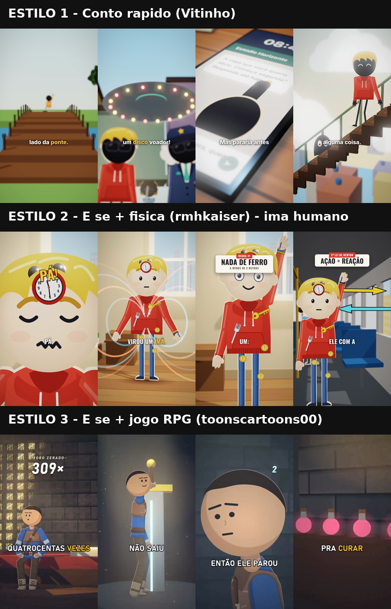

# Os 4 estilos de vídeo do repositório

Antes de começar um vídeo, escolha o estilo. Se a pessoa não disser qual, pergunte.

| | **Estilo 1: Conto rápido** | **Estilo 2: "E se" + física** | **Estilo 3: "E se" + jogo** | **Estilo 4: Vitinho completo** |
|---|---|---|---|---|
| Inspiração | @aprendendocomvitinho1 | @rmhkaiser | @toonscartoons00 | @aprendendocomvitinho1 (fala **e** visual) |
| Vídeos nossos | O topo, O roteiro, Nesta cidade todo mundo é cego | Ímã humano | Cidade do jogo (visual do 3 com a fala rápida do 1) | A mãe do Tiaguin (roteiro 09) |
| Estudo | `estudo-vitinho/README.md` + `GUIA-RITMO-E-SOM.md` | `ESTUDO-RMHKAISER.md` | `ESTUDO-TOONSCARTOONS.md` | `estudo-vitinho/README.md` + **`estudo-vitinho/DINAMISMO.md`** |
| Gancho | "Nesta cidade…", conto emocional | "E se você…?" + personagem com nome | "E se você acordasse dentro do jogo…?" + personagem gamer | "Nessa cidade…" + narrador em 1ª pessoa |
| História | Fantasia com lição de vida, emoção | Superpoder com consequência física explicada | Regra de jogo contra a vida real: "No jogo… Aqui…" | Igual ao Estilo 1 (rir primeiro, emocionar depois) |
| Duração | 1:30 a 2:00 | ~1:30 | ~1:50 | 1:40 a 2:30 |
| Palavras por segundo | **3,5 a 3,8** (3,65) | **~2,9** | **~2,7** | **3,5 a 3,8** (3,65) |
| Roteiro | duração × 3,65 | duração × 2,9 (90 s ≈ 260) | duração × 2,7 (110 s ≈ 300) | duração × 3,65 |
| Voz (ElevenLabs) | velocidade 1,10 a 1,15 | velocidade 1,0 | velocidade 1,0 | velocidade 1,10 a 1,15 |
| `novo_video.py` | padrão (`--pausa 0.18`) | `--vel 1.0 --pausa 0.35` | `--vel 1.0 --pausa 0.45` | padrão (`--pausa 0.18`) |
| Pausas | até 0,2 s | até 0,35 s | até 0,45 s, antes das viradas | até 0,2 s |
| Troca de imagem | a cada 2 a 3,5 s | a cada ~2,2 s | a cada ~2,5 s, com muitos closes | desenho novo a cada 2 a 3 s **+ uma batida a cada ~0,8 s** |
| Personagens (protagonista sempre o Tiaguin) | Cabeça preta lisa (Tiaguin loiro) | Rosto de pele com expressões (`kit-extras/estilo-b/char.js`) | Rosto de pele + roupa de aventureiro de RPG | **2D flat de recorte:** cabeça grande, olhão com 2 brilhos, braço de pílula, contorno fino |
| Luz e cor | Clara, dia, cores do kit | Clara, granulado leve, vinheta | **Escura e de cinema:** fim de tarde roxo, masmorra, tocha, luz estourada | Pastel; a cor conta a história (cinza na tristeza, quente na virada) |
| Legenda | Frase normal, pequena, embaixo do meio, palavra-chave amarela | CAIXA ALTA grossa (Oswald), 3 palavras, amarelo e vermelho | CAIXA ALTA semicondensada (tipo DIN), menor, amarelo | 1 a 3 palavras, **karaokê** (a palavra falada acende em amarelo), fonte arredondada grossa |
| Informação na tela | Pouca | Cards brancos com etiqueta vermelha, "PÁ!", diagramas em papel bege | **HUD de jogo:** painel escuro, nível, barra de vida, dano "-1", "+100", "NÍVEL 2", cronômetro | Números e placas dentro do desenho (relógio, "10 cm", calendário) |
| Trilha | -24 dB, abaixa 9 na fala | -21 dB, abaixa 6 na fala | -21 dB, abaixa 6 na fala | -24 dB, abaixa 9 na fala |
| Efeitos | Poucos, ~1 a cada 6 s | Nas ações fortes, ~1 a cada 4 s, junto com "PÁ!" | Sons de jogo (nível, dano, menu, moeda) junto com o HUD | Poucos, ~1 a cada 6 s |
| Final | Fechado, emocional | Fechado + pergunta para quem assiste | Fechado + pergunta. Se virar série, cada parte tem que funcionar sozinha. | Fechado, ou aberto com pergunta (se a pessoa pedir) |
| Exemplo de som | `videos/o-roteiro/som.json` | `videos/ima-humano/som.json` | `videos/cidade-do-jogo/som.json` | `videos/o-roteiro/som.json` |

## Estilo 1: Conto rápido
- Regras completas em `GUIA-RITMO-E-SOM.md`. É o padrão das instruções em `CLAUDE.md`.
- Usa o kit sem mudanças, com `ferramentas/kit-extras/cortes.js` para os cortes secos.

## Estilo 2: "E se" + física
- Peças em `ferramentas/kit-extras/estilo-b/` (veja o `LEIA.md` de lá):
  - rosto de pele;
  - granulado;
  - legenda `"estilo": "rmh"` com `card`, `quadrinho` e `numero`;
  - fonte Oswald.
- Projeto de exemplo: `videos/ima-humano/`.

## Estilo 3: "E se" + jogo
- Peças em `ferramentas/kit-extras/estilo-c/` (veja o `LEIA.md` de lá):
  - legenda `"estilo": "jogo"` (Barlow);
  - HUD: `hud`, `vida`, `dano`, `titulo`, `aviso`, `gancho`;
  - sons de jogo: `ferramentas/sons_jogo.py`.
- Rosto de pele e granulado vêm do Estilo 2 (`estilo-b/char.js` e `core.js`).
- Projeto de exemplo, com cidade ao entardecer, telão, etiquetas de nível em cima da cabeça, arena low-poly, fogueiras, zona de luz e placar no céu: `videos/cidade-do-jogo/`.
- **Variação já testada:** visual do Estilo 3 com a fala rápida do Estilo 1 (3,67 palavras/s, `--vel 1.1 --pausa 0.2`).
- **Ainda não feito:** masmorra, cronômetro fixo, cartão de item com raridade, menu "INDISPONÍVEL" e roupa de aventureiro.

## Estilo 4: Vitinho completo (fala + visual + movimento)
- É o Estilo 1 com o **visual 2D do próprio Vitinho** e o **movimento dele**. O estudo quadro a quadro está em `estudo-vitinho/DINAMISMO.md`:
  - cada plano chega com um zoom que freia (3x → 1x em 0,23 s, expo.out);
  - a câmera nunca para (deriva de 3% por segundo);
  - close e plano aberto são o mesmo desenho, com a câmera voando;
  - as trocas são corte seco na palavra, chicote com borrão (2 a 3 quadros), fusão casada (0,33 s) e pop-in girando;
  - pose e expressão são trocadas na palavra.
- **Abertura:** close extremo do rosto com a piada da regra (0 a 0,55 s), depois voo para trás de 3x em 0,45 s até a cidade inteira, depois um passeio grande de câmera por frase até ~8 s. A câmera anda 3 a 4x mais rápido que no resto.
- Roteiro de exemplo: `roteiros/09-a-mae-do-tiaguin-*`.
- **Ainda não feito:** peças 2D (Tiaguin, mãe e cenários em SVG), câmera 2D com GSAP e legenda karaokê.

